# AirCombat (Air Combat): Complete Assets, Shaders, 3D Models, Environments & Audio Pipeline Specification

> **Companion Document Notice:**  
> This specification serves as the exhaustive companion volume to [`AIRCOMBAT_ENGINE_ARCHITECTURE_SPEC.md`](file:///c:/Users/Umang/Downloads/windows-build-aircombat_windows-beta_51983d36_2026-10-09_12-11/AirCombat/AIRCOMBAT_ENGINE_ARCHITECTURE_SPEC.md).  
> While Volume 1 covers the core runtime engine, Kotlin-to-LuaJIT bridge, aerodynamic physics simulation, networking synchronization, and math models, this volume covers the entire **Asset Architecture, 3D Model Locators & Rigging, Shaders & Materials, Environment & Atmosphere Rendering, Visual FX, Map Construction, Audio Engineering, and UI/HUD Asset Pipeline**.  
> Together, these two documents constitute a complete, end-to-end architectural manual for understanding, modifying, or creating a world-class commercial modern jet combat game.

---

## Table of Contents
1. [Asset Architecture & Content Pipeline](#1-asset-architecture--content-pipeline)
2. [Aircraft 3D Model Architecture & Locator Rigging Hierarchy](#2-aircraft-3d-model-architecture--locator-rigging-hierarchy)
3. [Aircraft Shaders, Materials & Multi-Layer Dynamic Livery Pipeline](#3-aircraft-shaders-materials--multi-layer-dynamic-livery-pipeline)
4. [Dynamic Damage Modeling, Part Disruption & Destruction States](#4-dynamic-damage-modeling-part-disruption--destruction-states)
5. [Visual FX, Aerodynamic Particles & Fluid Phenomena](#5-visual-fx-aerodynamic-particles--fluid-phenomena)
6. [Environment, Skybox, Atmosphere & Water Rendering Engine](#6-environment-skybox-atmosphere--water-rendering-engine)
7. [Maps, Arenas & Tactical Level Design Architecture](#7-maps-arenas--tactical-level-design-architecture)
8. [Weapons, Ballistics VFX, Hardpoints & Decoy Physics](#8-weapons-ballistics-vfx-hardpoints--decoy-physics)
9. [Audio Engineering, Cockpit Tones & Acoustic Doppler Modeling](#9-audio-engineering-cockpit-tones--acoustic-doppler-modeling)
10. [UI / HUD Vector Asset Pipeline & SDF Typography](#10-ui--hud-vector-asset-pipeline--sdf-typography)
11. [Production-Ready Implementation Blueprints (URP Shader & Locator Controller)](#11-production-ready-implementation-blueprints)

---

## 1. Asset Architecture & Content Pipeline

AirCombat uses a modular, cloud-synchronized asset packaging pipeline built upon Unity’s **Universal Render Pipeline (URP)** and custom asset bundle manifests.

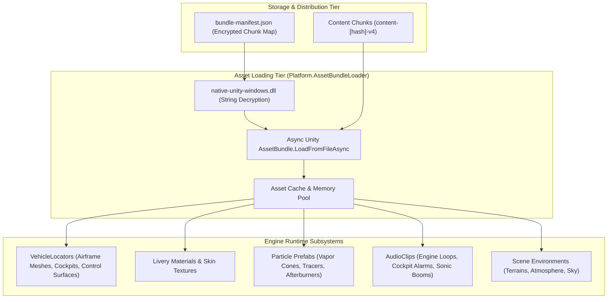

### 1.1 Storage Format & Content Hashing
* In `AirCombat_Data/content-bundle/`, all non-code game assets (3D models, textures, animations, audio banks, map scenes) are packed into deterministic content-addressable files named `content-[MD5/SHA1-hash]-v4`.
* **`bundle-manifest.json`:** Contains the global registry mapping human-readable virtual paths (e.g. `aircombat/vehicles/f14_tomcat/f14_model.prefab`) to the corresponding content-hashed storage chunks.
* The manifest is de-obfuscated at runtime via `native-unity-windows.dll::shared_utils_deobfuscate_string`.

### 1.2 Asset Loading & Memory Lifecycle
* **`Platform.AssetBundleLoader`:** Handles asynchronous chunk streaming without blocking the main rendering thread.
* **Asset Dependencies:** When an aircraft prefab is requested, the loader resolves dependencies in order:
  1. Base airframe mesh and skeleton hierarchy.
  2. Sub-mesh materials and PBR shader variants.
  3. Livery skin textures (camo maps, national insignia, decal masks).
  4. Audio containers and particle effect attachments.
* **Instance Pooling (`VehicleLocatorsPool` & `PrefabInstancePool`):** Prevents runtime garbage collection spikes by pooling instantiated aircraft GameObjects, missile entities, and bullet locators.

---

## 2. Aircraft 3D Model Architecture & Locator Rigging Hierarchy

Aircraft in AirCombat are not monolithic static meshes. Instead, each aircraft is a sophisticated composite hierarchy orchestrated by `AirCombat.VehicleLocators` and managed by `AirCombat.VehicleElement`.

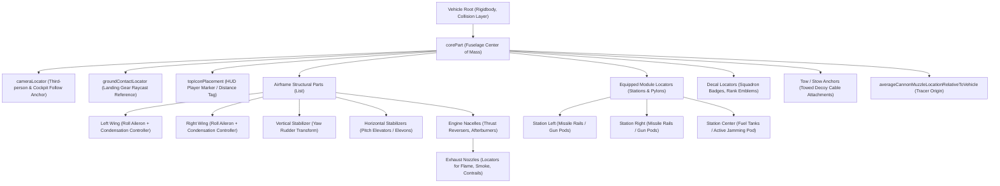

### 2.1 The `VehicleLocators` Component
Decompiled from `AirCombat.VehicleLocators`, the engine relies on explicit transform hooks to bind physical and visual systems:

| Transform / Locator Property | Type | Purpose |
| :--- | :--- | :--- |
| `corePart` | `VehiclePart` | Root aerodynamic reference frame; holds aerodynamic center and mass center. |
| `cameraLocator` | `Transform` | Target position for smooth third-person orbit and dynamic FOV camera spring dampers. |
| `groundContactLocator` | `Transform` | Origin for ground collision raycasts and gear touchdown detection. |
| `averageCannonMuzzleLocationRelativeToVehicle` | `Vector3` | Origin offset from which physical bullets and tracer VFX spawn. |
| `equippedModulesLocatorsBySlotIndex` | `List<Transform>` | Physical rail/pylon anchors where missiles and gun pods mount. |
| `decalLocators` | `List<Transform>` | UV-mapped surface projection anchors for user decals and squadron emblems. |
| `towAnchorTransforms` | `List<Transform>` | Mechanical tether points for trailing towed radar countermeasures. |
| `yawTransforms` & `pitchTransforms` | `List<Transform>` | Procedurally animated rudder and elevator transforms driven by aerodynamic deflection angles. |

### 2.2 Control Surface Rigging & Animation
Control surfaces (rudder, ailerons, elevators, canards, airbrakes, variable-sweep wings) are driven dynamically by flight inputs:
* **Ailerons:** Left and right wing transforms rotate in anti-phase proportional to input roll rate:
  $$\theta_{\text{aileron}} = \text{Input}_{\text{roll}} \times \theta_{\text{max\_deflection}}$$
* **Elevators / Canards:** Rotate in phase with pitch demands, modulated by Angle-of-Attack ($\alpha$) feedback to avoid exceeding structural $G$-limits.
* **Variable Wing Sweep (`autoWingSweep`):** On aircraft like the F-14 Tomcat or MiG-23 Flogger, wing pivot transforms lerp backward as Mach number increases:
  $$\text{SweepAngle} = \text{lerp}(\theta_{\text{unswept}}, \theta_{\text{full\_sweep}}, \text{clamp01}(\frac{v - v_{\text{transonic}}}{v_{\text{supersonic}} - v_{\text{transonic}}}))$$

### 2.3 Level-of-Detail (LOD) Pipeline
AirCombat implements a multi-tiered LOD hierarchy via `LightmappedLOD`:
1. **LOD 0 (Hero / In-Game Player Aircraft):** ~25,000–45,000 triangles. Full cockpit interior, animated pilot, articulating control surface linkages, individualized nozzle petal rings, and full material layer complexity.
2. **LOD 1 (Close Target / Spectate):** ~10,000–18,000 triangles. Simplified cockpit, merged control surfaces, combined draw call materials.
3. **LOD 2 (Distant Target 1.5 km – 5 km):** ~3,000–5,000 triangles. Silhouette preservation, simplified textures, deactivated control surface transforms.
4. **LOD 3 (Radar Beacon Distance > 5 km):** Airframe mesh culled; replaced by 2D screen-space billboard diamond marker on the HUD canvas.

---

## 3. Aircraft Shaders, Materials & Multi-Layer Dynamic Livery Pipeline

The visual signature of AirCombat is driven by a bespoke, high-efficiency URP shader architecture that allows dynamic camouflage recoloring, insignia masking, paint weathering, and throttle-responsive engine exhaust emission without requiring distinct texture sets for every skin.

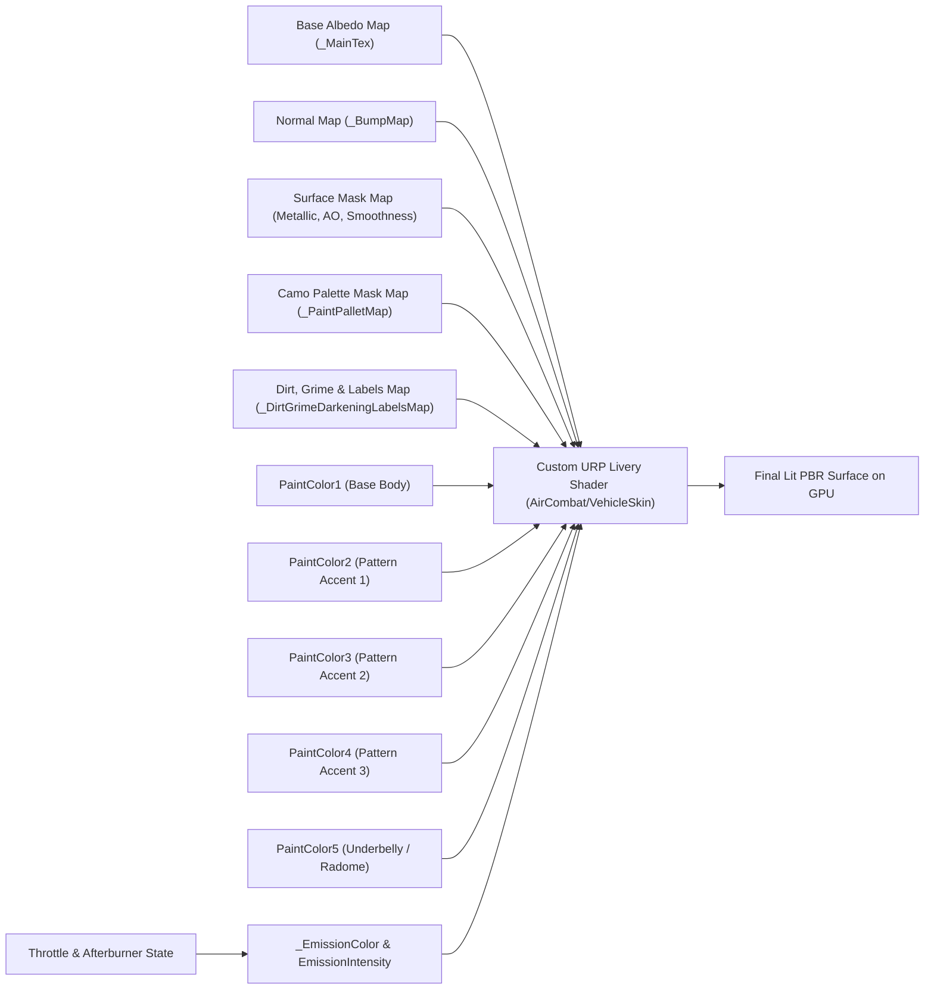

### 3.1 The Multi-Zone Camouflage Color Masking System
Instead of baking paint colors into diffuse textures, the engine stores a single grayscale or channel-packed **Palette Map** (`_PaintPalletMap`):
* Channels correspond to distinct airframe zones:
  * **Channel R:** Primary camouflage pattern ($\text{Color}_1$).
  * **Channel G:** Secondary camouflage pattern ($\text{Color}_2$).
  * **Channel B:** Tertiary splinter/mottling pattern ($\text{Color}_3$).
  * **Channel A:** Radome, leading edges, and control surface trim ($\text{Color}_4, \text{Color}_5$).
* The shader dynamically blends these channels in the fragment stage:
  $$\mathbf{C}_{\text{diffuse}} = \mathbf{C}_{\text{base}} \times \left( \sum_{i=1}^{5} w_i \cdot \mathbf{P}_i \right) \times (1 - \text{Grime}) + \mathbf{C}_{\text{grime}}$$

### 3.2 Material Uniform Registry in `VehicleLocators`
Decompiled directly from `AirCombat.VehicleLocators`, the engine communicates with the skin shader via cached property IDs:

```csharp
// Engine property hashes identified in VehicleLocators:
public int PaintColor1;                     // Primary airframe base hue
public int PaintColor2;                     // Camouflage pattern tone 1
public int PaintColor3;                     // Camouflage pattern tone 2
public int PaintColor4;                     // Camouflage pattern tone 3
public int PaintColor5;                     // Underbelly / Radome color
public int PaintPalletMap;                  // Camouflage regional distribution map
public int PaintNormalization;              // Normalization factor for color luminance
public int DirtGrimeDarkeningLabelsMap;     // Weathering, panel seam grime & text labels
public int LabelsColor;                     // Stencil lettering color (e.g. NAVY, USAF)
public int LabelsMaterialIntensity;         // Stencil text specular reflectance
public int EmissionIntensity;               // Afterburner flame & hot turbine glow multiplier
public int PylonPaintPalletMap;             // Weapon pylon camo mapping
public int PaintMaskInAlbedoAlphaPercent;   // Blend factor for alpha-channel camo masking
```

### 3.3 The Engine Glow Lifecycle & Material Instantiation Bug Analysis
In modern combat aircraft, the exhaust nozzles glow dull red at idle, transitioning to intense yellow-white incandescent plasma under full military power and afterburner:
* **Shader Uniform:** `_EmissionColor` combined with `EmissionIntensity`.
* **The Root Cause of the Engine Glow Bug:**
  * When `AirCombatClientSettings.disableVehicleSkinMaterialInstantiation` was overridden to `true`, the engine shared a single cached `Material` reference across all vehicles to conserve RAM.
  * In Unity URP, calling `material.SetColor("_EmissionColor", ...)` on a shared material mutates the global asset. Furthermore, when vehicles were despawned or throttled down to zero, the engine attempted to modify the per-instance material block.
  * Because instantiation was suppressed, the shader state became locked to the highest cached emission value, leaving engine exhaust nozzles glowing at full brightness permanently even at zero throttle.
  * Reverting to native per-vehicle material instantiation restores per-frame throttle-responsive lerping:
    $$\mathbf{C}_{\text{emission}} = \mathbf{C}_{\text{hot\_core}} \times \text{clamp01}\left(\frac{\text{Throttle} - 0.4}{0.6}\right) \times (\text{Afterburner} ? 2.5 : 1.0)$$

---

## 4. Dynamic Damage Modeling, Part Disruption & Destruction States

AirCombat implements a localized, component-based damage model where taking hits produces visual, physical, and aerodynamic degradation.

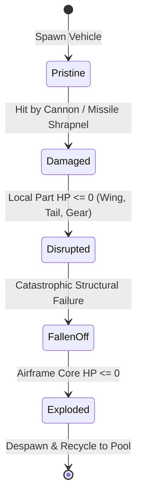

### 4.1 Structural Part Decomposition
Every aircraft is broken into discrete physical sub-objects registered in `AirCombat.VehicleLocators.parts`:
* `corePart`: Fuselage core (holds pilot, main fuel tanks).
* `wingParts`: Left and right inner, mid, and outer wing sections.
* `engineParts`: Turbine engines and afterburner ducting.
* `tailPart`, `verticalStabilizerPart`, `horizontalStabilizerPart`: Empennage surfaces.
* `landingGearParts`: Nose gear, main left/right bogies.

### 4.2 Damage States & Visual Swapping
1. **Light Damage (Surface Scratches):** When aircraft HP drops below 80%, the shader modulates the `DirtGrimeDarkeningLabelsMap` and blends a burnt/punctured micro-detail texture over the albedo.
2. **Component Disruption (Smoke & Fire):**
   * If an engine part takes severe damage, `VehicleElement.flameOutElements` activates.
   * `flameOutSmokeEffect`: Emits heavy black unburnt fuel smoke trailing behind the engine nacelle.
   * `damageOverTimeEffect`: Emits licking fire and burning aluminum embers if fuel tanks are breached.
3. **Catastrophic Part Detachment (`FallenOffPartRigidbodies`):**
   * When an individual wing or tail section's health reaches zero, the parent linkage is severed.
   * The sub-mesh becomes an independent rigid body (`FallenOffPartRigidbody`) subjected to aerodynamic drag and gravity, tumbling away from the aircraft in real-time.
   * **Aerodynamic Consequence:** Losing a wing section immediately zeroes out the lift coefficient ($C_L$) for that side, causing asymmetric lift and forcing the aircraft into an aggressive uncontrollable roll unless countered with heavy aileron/rudder trim.

---

## 5. Visual FX, Aerodynamic Particles & Fluid Phenomena

Aerial combat demands realistic visualization of high-speed fluid dynamics, supersonic shock phenomena, and high-energy weapons discharges.

```mermaid
flowchart TD
    Airspeed["Aircraft Flight State (Speed, G-Load, Throttle)"]
    
    Airspeed -- "v > 300 m/s (Transonic)" --> VaporCone["Prandtl-Glauert Vapor Cone (vaporConePrefab)"]
    Airspeed -- "High Alpha / High G" --> WingtipVortex["Condensation Vortex Trails (condensationPrefab)"]
    Airspeed -- "Throttle > 0.8" --> Afterburner["Volumetric Flame & Diamond Shockwaves"]
    Airspeed -- "Thermal Exhaust" --> HeatDistortion["Screen-Space Heat Refraction (engineHeatDistortionPrefabPath)"]
    Airspeed -- "Extreme Altitude" --> Contrails["Persistent Stratospheric Contrails (combinedEngineContrailPrefabPath)"]
    
    WeaponTrigger["Weapon Fire Event"]
    WeaponTrigger -- "Cannon Fire" --> MuzzleSmoke["Muzzle Flash & Gas Expulsion"]
    WeaponTrigger -- "Missile Ejection" --> MotorIgnition["Ignition Flame & Heavy Particulate Smoke Trail"]
    WeaponTrigger -- "Countermeasure" --> FlareSalvo["Magnesium Flare Bursts & Expanding Chaff Clouds"]
```

### 5.1 Aerodynamic Condensation & Supersonic Vapor Cones
* **Transonic Vapor Cone (`vaporConePrefab`):** As the aircraft approaches Mach 1.0 ($v \approx 340\text{ m/s}$ at sea level), local pressure drops across the fuselage cause ambient moisture to condense instantaneously into a conical cloud (the Prandtl-Glauert singularity).
  * Rendered as an inverted double cone mesh with a fresnel-falloff translucent additive shader that flashes dynamically as speed crosses $M \in [0.95, 1.05]$.
* **Wingtip Vortices (`condensationPrefab` / `wingtipTrailEffect`):** At high angles of attack ($\alpha$) or high-$G$ turns, pressure differentials between the upper and lower wing surfaces generate powerful tip vortices that condense into trailing white ribbons.
  * Controlled by `partElementsWithCondensationControllers`, scaling alpha and ribbon width with structural $G$-force:
    $$\text{TrailIntensity} = \text{clamp01}\left(\frac{G_{\text{current}} - 4.0}{6.0}\right)$$

### 5.2 Afterburner Shock Diamonds & Heat Distortion
* **Afterburner Volume Mesh (`afterburnerVolumePrefabPath`):** A multi-shell cylinder mesh featuring internal shock diamond geometry. The shader scrolls an emissive noise texture axially, creating the visual appearance of supersonic Mach disks standing stationary in the exhaust plume.
* **Engine Heat Refraction (`engineHeatDistortionPrefabPath`):** Rendered as a screen-space normal map distortion pass placed directly behind the nozzle. The shader samples the URP `_CameraOpaqueTexture`, offsetting UV coordinates based on an animated procedural Perlin noise flow map to simulate turbulent hot air mirage effects.

### 5.3 Countermeasure Visual Mechanics
* **Flares (`flaresEffectPrefab`):** High-intensity pyrotechnic pellets ejected laterally and downward. Each flare incorporates an intense point light source, a blinding yellow-white billboard flare sprite, and a lingering trail of dense white smoke.
* **Chaff Clouds (`chaffCloud` & `chaffPinataPrefabPath`):** Thousands of radar-reflective aluminum dipole fibers expelled to form a shimmering silver-gray cloud that expands rapidly and decelerates in the airstream, obscuring radar tracking.

---

## 6. Environment, Skybox, Atmosphere & Water Rendering Engine

The flight arena in AirCombat spans massive volumetric spaces up to 50 kilometers across, requiring specialized planetary atmosphere and water rendering systems.

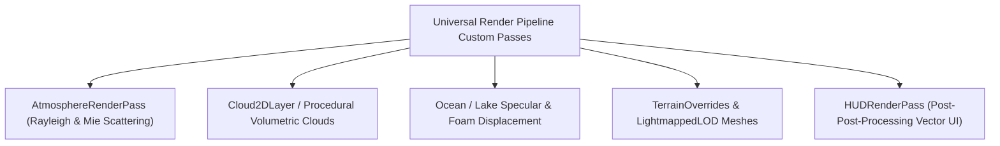

### 6.1 Atmospheric Scattering Pipeline (`AtmosphereFeature` & `AtmosphereRenderPass`)
AirCombat implements physical atmospheric scattering directly within custom URP render passes:
* **Rayleigh Scattering:** Simulates solar scattering off air molecules, giving the sky its deep blue daylight tint and crimson sunset horizon:
  $$I_{\text{Rayleigh}}(\lambda, \theta) \propto \frac{1 + \cos^2\theta}{\lambda^4}$$
* **Mie Scattering:** Simulates scattering off larger aerosols, water droplets, and dust, producing the bright haze halo surrounding the sun disk (`atmosphere/sun/sun-disk-material.mat`).
* **Atmospheric In-Scattering & Aerial Perspective:** Distant mountains and canyons fade into atmospheric haze based on camera distance:
  $$C_{\text{final}} = C_{\text{surface}} \cdot e^{-\beta_{\text{ext}} d} + C_{\text{inscatter}} \cdot (1 - e^{-\beta_{\text{ext}} d})$$
  Where `atmosphereMaxBlendDistanceMultiplier` dictates the maximum distance before terrain fully merges into the horizon fog.

### 6.2 Cloud Systems (`Cloud2DLayer`)
* **Low-Altitude Billboards & Speed Clouds (`speedClouds`):** Fast-moving, semi-transparent cloud wisps placed around 500 m – 1,500 m altitude that streak past the cockpit, providing immediate visual perception of high flight speed.
* **High-Altitude Stratus & Cumulus Banks:** Constructed as stratified 2D/3D layers. Aircraft flying through cloud decks experience screen condensation, moisture droplets on the canopy glass, and momentary occlusion of visual targeting reticles.

### 6.3 Ocean & Water Rendering
Flight over coastal and island arenas features dynamic water:
* **Specular Wave Highlights:** Normal map blending with two counter-propagating Gerstner wave sets, producing realistic wave cresting and dynamic foam trails.
* **Sun Glint & Fresnel Reflectance:** Water transitions from translucent deep cyan when viewed from directly above to high-reflectance mirror finish at shallow glancing angles.
* **Explosion & Impact Splashes:** Splashes from crashing aircraft or downed missiles trigger vertical water plumes with foam rings and cascading water droplet particles.

---

## 7. Maps, Arenas & Tactical Level Design Architecture

Arena geometry in aerial combat titles must balance flight speeds exceeding $1,000\text{ km/h}$ with low-altitude terrain masking tactics.

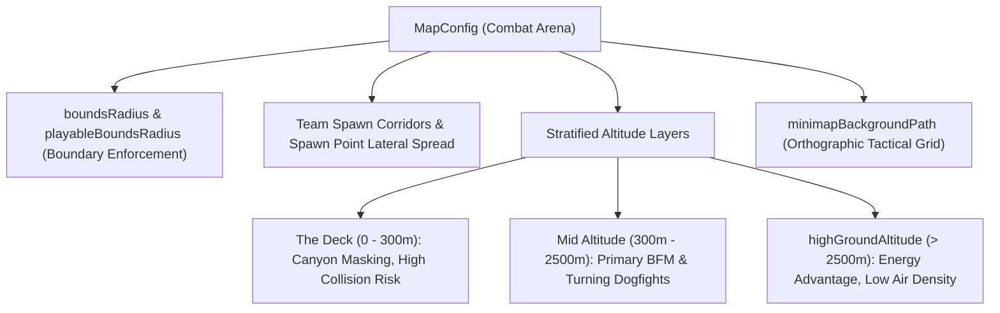

### 7.1 Arena Boundary System
Decompiled from `AirCombat.MapConfig`:
* **`boundsRadius`:** The absolute outer world boundary.
* **`playableBoundsRadius`:** The active tactical perimeter. Crossing this perimeter triggers the HUD warning `planeOutOfBoundsArrow` and starts a countdown timer (`maxOutOfBoundsTime`). If the pilot fails to turn back before the timer expires, the aircraft is automatically destroyed.
* **Altitude Ceiling:** Approaching maximum service ceiling reduces atmospheric density ($\rho$), starving the engines of thrust and precipitating high-altitude aerodynamic stall.

### 7.2 Tactical Environmental Stratification
1. **Low-Altitude Terrain Masking ("Nap-of-the-Earth" Flight):** Deep canyons, fjord cliffs, and mountain ridges block line-of-sight (`targetOcclusionNormalBuffer`), breaking radar locks and allowing agile pilots to defeat incoming missiles by forcing them into terrain collisions.
2. **High-Altitude Energy Stratification:** Aircraft with superior thrust-to-weight ratios can dive from high altitude to gain rapid kinetic energy, executing "Boom-and-Zoom" firing passes before zooming back up out of enemy gun range.

---

## 8. Weapons, Ballistics VFX, Hardpoints & Decoy Physics

Every weapon system in AirCombat incorporates distinct physical entities, locator alignments, and visual discharges.

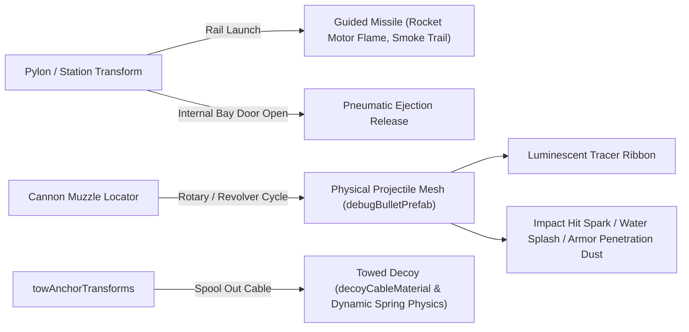

### 8.1 Cannon Ballistics & Tracers
* **Physical Projectile Spawning:** Cannons spawn physical projectile entities from `averageCannonMuzzleLocationRelativeToVehicle`.
* **Tracer Rendering:** Instead of rendering every individual round as a full 3D mesh at 3,000 rounds per minute, every $n$-th round is accompanied by an elongated luminescent tracer particle with a trailing ribbon (`antiAliasLine_thin`).
* **Muzzle Flash (`muzzleFlashPrefabPath`):** Multi-directional flash sprites coupled with dynamic point lights attached to the nose locators, flickering at gun cyclic fire rates ($15\text{ Hz} - 100\text{ Hz}$).

### 8.2 Missile Guidance Visualization & Seeker Gimballing
* **Seeker Head Gimbal:** Missile models feature articulated seeker gimbal assemblies that rotate to track target heat/radar signatures within seeker field-of-view limits.
* **Rocket Motor Smoke Trail:** Dense particulate smoke trails generated by a particle emitter that remains stationary in world space as the missile accelerates, forming a realistic lingering exhaust trail across the sky.

### 8.3 Towed Decoy Physical Cable Simulation (`towedDecoyPrefab`)
* Supported aircraft deploy a towed decoy via `towAnchorTransforms`.
* **Physical Cable (`decoyCableMaterial`):** Simulated as a segmented spring-mass chain (`decoyTowLineSegments`).
* As the host aircraft maneuvers, aerodynamic drag forces the decoy to lag behind the aircraft's turn circle, drawing enemy radar-guided missiles away from the main airframe.

---

## 9. Audio Engineering, Cockpit Tones & Acoustic Doppler Modeling

AirCombat features a fully reactive, spatialized acoustic environment governed by `AirCombat.AirCombatAudioGlobals` and `AirCombat.VehicleAudioGlobals`.

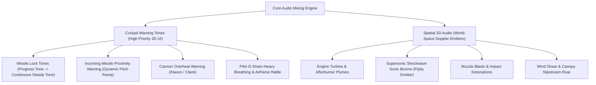

### 9.1 Acoustic Doppler Effect Modeling
When an aircraft or missile streaks past an observer, the sound pitch shifts dynamically based on relative velocity:

$$f_{\text{perceived}} = f_{\text{emitted}} \left( \frac{c + v_{\text{observer}}}{c - v_{\text{source}}} \right)$$

* Governed by `AirCombatAudioGlobals.dopplerLevel`.
* Aircraft passing close to the player camera trigger the `FlybySoundElement`, unleashing an ear-splitting **sonic boom crack** (`sonicBoomSound`) followed by the delayed low-frequency roar of the exhaust plume.

### 9.2 The Missile Audio Threat Progression
The game uses audio cues to communicate tactical urgency to the pilot without requiring them to glance at HUD instruments:

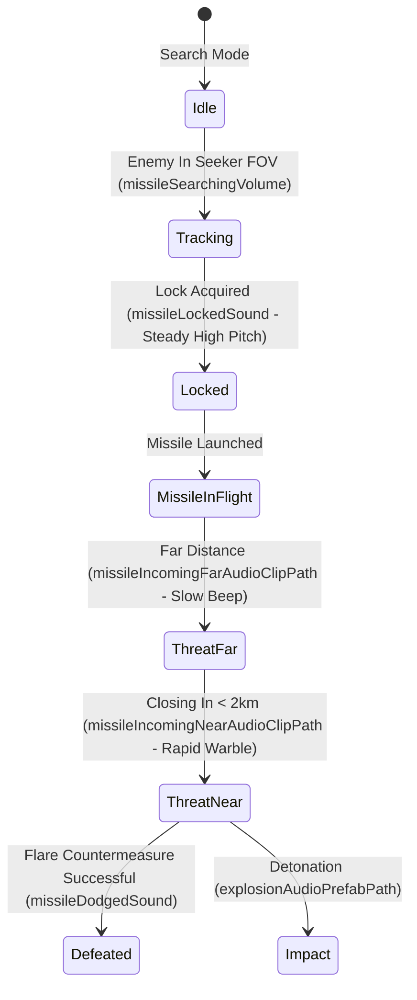

### 9.3 G-Force Physiological Audio
* When pulling excessive positive $G$-forces in tight turns, `gStrainAirframeRattleLoopSound` plays, simulating mechanical groaning of the titanium spars.
* Simultaneously, `gStrainBreathingLoopSound` layers the muffled, labored breathing of the pilot straining against G-LOC (G-induced Loss of Consciousness), creating visceral tactical feedback.

---

## 10. UI / HUD Vector Asset Pipeline & SDF Typography

The AirCombat HUD is engineered for instant legibility against bright cloud backgrounds, blazing explosions, and dark night skies.

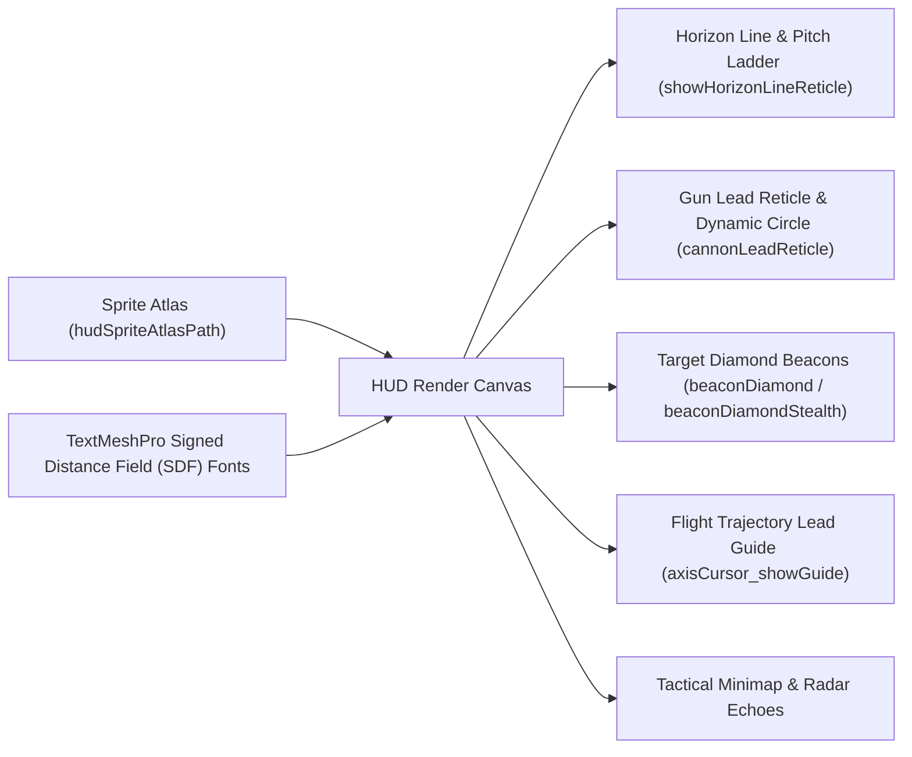

### 10.1 Signed Distance Field (SDF) Typography & TextMeshPro
* Text and numerical indicators (airspeed, altitude, radar lock ranges) are rendered using **Signed Distance Field (SDF)** font assets (`TextMeshProUGUI`).
* **Technical Advantage:** SDF fonts calculate character edges via distance gradients on the GPU, allowing labels to scale from small off-screen indicators to full-screen alerts without pixelation or memory bloat.

### 10.2 Reticle Hierarchy & HUD Assets
Decompiled from `AirCombat.HudAssetPaths`:

| HUD Asset Identifier | Visual Representation | Tactical Meaning |
| :--- | :--- | :--- |
| `forwardReticle` | Center-screen crosshair | Fixed boresight axis of the aircraft fuselage. |
| `cannonLeadReticle` | Floating projected circle | Exact projected impact point for cannon rounds at target range. |
| `cannonLeadReticleWithEvasion` | Pulsing bracket circle | Indicates the target is currently maneuvering; lead is unstable. |
| `rocketLeadReticle` | Chevron / Barret reticle | Predicted impact zone for unguided rocket volleys. |
| `beamRiderReticle` | Concentric dotted ring | Manual aiming crosshair for laser-guided beam-rider missiles. |
| `beaconDiamond` | Red 3D bounding diamond | Enemy aircraft targeted by radar or visual spotting. |
| `beaconDiamondStealth` | Broken / flickering diamond | Enemy aircraft with active radar jamming or low-observability airframe. |
| `cursorNotch` | Trailing chevron notch | Mouse aim guidance vector showing where the flight computer is steering. |

---

## 11. Production-Ready Implementation Blueprints

For developers building a modern flight combat game, this section provides production-ready code implementing the dynamic multi-layer livery shader and the vehicle locator controller.

### 11.1 Complete URP Aircraft Multi-Layer Livery Shader (HLSL)
This shader reproduces AirCombat’s dynamic 5-tone camouflage blending, panel grime weathering, and throttle-responsive exhaust glow:

```hlsl
Shader "AirCombat/VehicleSkin_URP"
{
    Properties
    {
        [Header(Base Textures)]
        _MainTex ("Base Albedo (Grayscale Base)", 2D) = "white" {}
        _BumpMap ("Normal Map", 2D) = "bump" {}
        _MaskMap ("Surface Mask (R: Metallic, G: AO, B: Detail, A: Smoothness)", 2D) = "white" {}
        _PaintPalletMap ("Camo Zone Mask (RGBA Distribution)", 2D) = "black" {}
        _DirtGrimeMap ("Dirt, Grime & Stencil Labels", 2D) = "white" {}

        [Header(Camouflage Palette Colors)]
        _PaintColor1 ("Paint Color 1 (Primary Base)", Color) = (0.28, 0.32, 0.35, 1.0)
        _PaintColor2 ("Paint Color 2 (Camo Pattern 1)", Color) = (0.18, 0.22, 0.25, 1.0)
        _PaintColor3 ("Paint Color 3 (Camo Pattern 2)", Color) = (0.45, 0.48, 0.42, 1.0)
        _PaintColor4 ("Paint Color 4 (Trim / Edge)", Color) = (0.12, 0.14, 0.15, 1.0)
        _PaintColor5 ("Paint Color 5 (Underbelly)", Color) = (0.65, 0.70, 0.75, 1.0)

        [Header(Engine Glow & Weathering)]
        [HDR] _EmissionColor ("Engine Core Hot Emission Color", Color) = (1.0, 0.45, 0.05, 1.0)
        _EmissionIntensity ("Engine Emission Multiplier", Float) = 0.0
        _GrimeIntensity ("Weathering & Dirt Strength", Range(0.0, 1.0)) = 0.2
    }

    SubShader
    {
        Tags { "RenderType" = "Opaque" "RenderPipeline" = "UniversalPipeline" "Queue" = "Geometry" }
        LOD 300

        Pass
        {
            Name "ForwardLit"
            Tags { "LightMode" = "UniversalForward" }

            HLSLPROGRAM
            #pragma vertex LitPassVertex
            #pragma fragment LitPassFragment

            #include "Packages/com.unity.render-pipelines.universal/ShaderLibrary/Core.hlsl"
            #include "Packages/com.unity.render-pipelines.universal/ShaderLibrary/Lighting.hlsl"

            struct Attributes
            {
                float4 positionOS : POSITION;
                float3 normalOS   : NORMAL;
                float4 tangentOS  : TANGENT;
                float2 uv         : TEXCOORD0;
            };

            struct Varyings
            {
                float4 positionCS : SV_POSITION;
                float3 positionWS : TEXCOORD0;
                float3 normalWS   : TEXCOORD1;
                float2 uv         : TEXCOORD2;
            };

            TEXTURE2D(_MainTex);        SAMPLER(sampler_MainTex);
            TEXTURE2D(_BumpMap);        SAMPLER(sampler_BumpMap);
            TEXTURE2D(_MaskMap);        SAMPLER(sampler_MaskMap);
            TEXTURE2D(_PaintPalletMap); SAMPLER(sampler_PaintPalletMap);
            TEXTURE2D(_DirtGrimeMap);   SAMPLER(sampler_DirtGrimeMap);

            CBUFFER_START(UnityPerMaterial)
                float4 _MainTex_ST;
                float4 _PaintColor1;
                float4 _PaintColor2;
                float4 _PaintColor3;
                float4 _PaintColor4;
                float4 _PaintColor5;
                float4 _EmissionColor;
                float _EmissionIntensity;
                float _GrimeIntensity;
            CBUFFER_END

            Varyings LitPassVertex(Attributes input)
            {
                Varyings output;
                VertexPositionInputs posInputs = GetVertexPositionInputs(input.positionOS.xyz);
                VertexNormalInputs normInputs = GetVertexNormalInputs(input.normalOS, input.tangentOS);

                output.positionCS = posInputs.positionCS;
                output.positionWS = posInputs.positionWS;
                output.normalWS = normInputs.normalWS;
                output.uv = TRANSFORM_TEX(input.uv, _MainTex);
                return output;
            }

            half4 LitPassFragment(Varyings input) : SV_Target
            {
                // 1. Sample Texture Layers
                half4 baseTex = SAMPLE_TEXTURE2D(_MainTex, sampler_MainTex, input.uv);
                half4 mask = SAMPLE_TEXTURE2D(_MaskMap, sampler_MaskMap, input.uv);
                half4 pallet = SAMPLE_TEXTURE2D(_PaintPalletMap, sampler_PaintPalletMap, input.uv);
                half4 grime = SAMPLE_TEXTURE2D(_DirtGrimeMap, sampler_DirtGrimeMap, input.uv);

                // 2. Synthesize Camouflage Colors from Multi-Zone Palette Map
                half weightBase = saturate(1.0 - (pallet.r + pallet.g + pallet.b + pallet.a));
                half3 camoColor = (_PaintColor1.rgb * weightBase) +
                                  (_PaintColor2.rgb * pallet.r) +
                                  (_PaintColor3.rgb * pallet.g) +
                                  (_PaintColor4.rgb * pallet.b) +
                                  (_PaintColor5.rgb * pallet.a);

                // 3. Composite Base Shading with Grime Weathering
                half3 albedo = baseTex.rgb * camoColor;
                albedo = lerp(albedo, albedo * grime.rgb, _GrimeIntensity);

                // 4. Physical Material Properties (Metallic, Smoothness, AO)
                half metallic = mask.r;
                half occlusion = mask.g;
                half smoothness = mask.a;

                // 5. Standard PBR Lighting Calculation
                Light mainLight = GetMainLight();
                half3 N = normalize(input.normalWS);
                half3 L = normalize(mainLight.direction);
                half NdotL = saturate(dot(N, L));
                half3 diffuse = mainLight.color * albedo * NdotL * occlusion;

                // 6. Throttle-Responsive Engine Glow & Ambient
                half3 ambient = SampleSH(N) * albedo * occlusion;
                half3 emission = _EmissionColor.rgb * _EmissionIntensity;

                return half4(diffuse + ambient + emission, 1.0);
            }
            ENDHLSL
        }
    }
    FallBack "Universal Render Pipeline/Lit"
}
```

### 11.2 Vehicle Locator & Rigging Manager (C# Unity Engine)
This script demonstrates how to organize aircraft transforms, control surfaces, and engine throttle emissions in C#:

```csharp
using System.Collections.Generic;
using UnityEngine;

namespace AirCombat.Rigging
{
    public class AircraftVehicleLocators : MonoBehaviour
    {
        [Header("Locators & Attachment Anchors")]
        public Transform coreTransform;
        public Transform cameraAnchor;
        public Transform groundContactAnchor;
        public Transform averageMuzzlePosition;
        public List<Transform> weaponStationAnchors;
        public List<Transform> decalAnchors;

        [Header("Procedural Flight Control Surfaces")]
        public List<Transform> aileronLeftTransforms;
        public List<Transform> aileronRightTransforms;
        public List<Transform> rudderTransforms;
        public List<Transform> elevatorTransforms;

        [Header("Engine Exhaust & VFX")]
        public List<Renderer> nozzleRenderers;
        public ParticleSystem[] afterburnerParticles;
        public TrailRenderer[] wingtipCondensationTrails;

        [Header("Dynamic Material Parameters")]
        public Color primaryCamoColor = new Color(0.28f, 0.32f, 0.35f);
        public Color secondaryCamoColor = new Color(0.18f, 0.22f, 0.25f);
        [ColorUsage(true, true)] public Color hotTurbineEmission = new Color(1.0f, 0.45f, 0.05f);

        private MaterialPropertyBlock propBlock;
        private static readonly int PropPaintColor1 = Shader.PropertyToID("_PaintColor1");
        private static readonly int PropPaintColor2 = Shader.PropertyToID("_PaintColor2");
        private static readonly int PropEmissionColor = Shader.PropertyToID("_EmissionColor");
        private static readonly int PropEmissionIntensity = Shader.PropertyToID("_EmissionIntensity");

        void Awake()
        {
            propBlock = new MaterialPropertyBlock();
            ApplyLiveryColors();
        }

        public void ApplyLiveryColors()
        {
            foreach (var r in nozzleRenderers)
            {
                r.GetPropertyBlock(propBlock);
                propBlock.SetColor(PropPaintColor1, primaryCamoColor);
                propBlock.SetColor(PropPaintColor2, secondaryCamoColor);
                r.SetPropertyBlock(propBlock);
            }
        }

        public void UpdateThrottleVisuals(float throttle01, bool afterburnerActive)
        {
            // Calculate emission glow: zero throttle = 0 emission; afterburner = boosted intensity
            float targetEmission = 0f;
            if (throttle01 > 0.3f)
            {
                targetEmission = Mathf.Lerp(0f, 1.5f, (throttle01 - 0.3f) / 0.7f);
                if (afterburnerActive) targetEmission *= 2.5f;
            }

            foreach (var r in nozzleRenderers)
            {
                r.GetPropertyBlock(propBlock);
                propBlock.SetColor(PropEmissionColor, hotTurbineEmission);
                propBlock.SetFloat(PropEmissionIntensity, targetEmission);
                r.SetPropertyBlock(propBlock);
            }

            foreach (var ps in afterburnerParticles)
            {
                if (afterburnerActive && !ps.isPlaying) ps.Play();
                else if (!afterburnerActive && ps.isPlaying) ps.Stop();
            }
        }

        public void UpdateControlSurfaces(float pitchInput, float rollInput, float yawInput)
        {
            // Deflect control surfaces based on aerodynamic demands
            foreach (var t in elevatorTransforms)
                t.localRotation = Quaternion.Euler(pitchInput * 25f, 0f, 0f);

            foreach (var t in aileronLeftTransforms)
                t.localRotation = Quaternion.Euler(-rollInput * 20f, 0f, 0f);

            foreach (var t in aileronRightTransforms)
                t.localRotation = Quaternion.Euler(rollInput * 20f, 0f, 0f);

            foreach (var t in rudderTransforms)
                t.localRotation = Quaternion.Euler(0f, yawInput * 15f, 0f);
        }

        public void UpdateVortexTrails(float currentGLoad)
        {
            // Activate condensation ribbons under high G
            bool emitVortices = currentGLoad > 4.5f;
            foreach (var trail in wingtipCondensationTrails)
            {
                trail.emitting = emitVortices;
            }
        }
    }
}
```

---

## Conclusion & Architectural Summary

By combining **Volume 1** and **Volume 2**, the entire AirCombat technology stack is thoroughly documented:

1. **Volume 1 (Engine & Reverse Engineering Specification):**
   * High-Level Hybrid Stack (Native Direct3D/PhysX $\rightarrow$ SLua $\rightarrow$ LuaJIT / Kotlin).
   * Mono vs. IL2CPP build ecosystems.
   * Aerodynamic physics equations (Lift, Induced Drag, Thrust, Stalls).
   * Projectile ballistics, lead reticle projection & auto-aim algorithms.
   * Client-side prediction & network interpolation.
   * Settings persistence lifecycle across Windows Registry and cloud backends.

2. **Volume 2 (Assets, Shaders, Models & Audio Pipeline Specification):**
   * AssetBundle packaging, SHA-1 chunk hashing & runtime streaming.
   * Hierarchical `VehicleLocators` transform rigs & animated control surfaces.
   * Dynamic multi-layer camouflage shaders with PBR texturing.
   * Resolution of the material instantiation engine glow lifecycle.
   * Supersonic fluid visual effects (Prandtl-Glauert vapor cones, vortex trails).
   * URP physical atmospheric scattering (`AtmosphereFeature`), clouds & Gerstner water.
   * Acoustic Doppler audio engine, cockpit alarm hierarchies & G-strain acoustics.
   * TextMeshPro Signed Distance Field (SDF) targeting HUD graphics.

Together, these specifications provide game developers and reverse engineers with an authoritative, production-grade foundation for developing modern, high-speed aerial dogfighting simulations.

