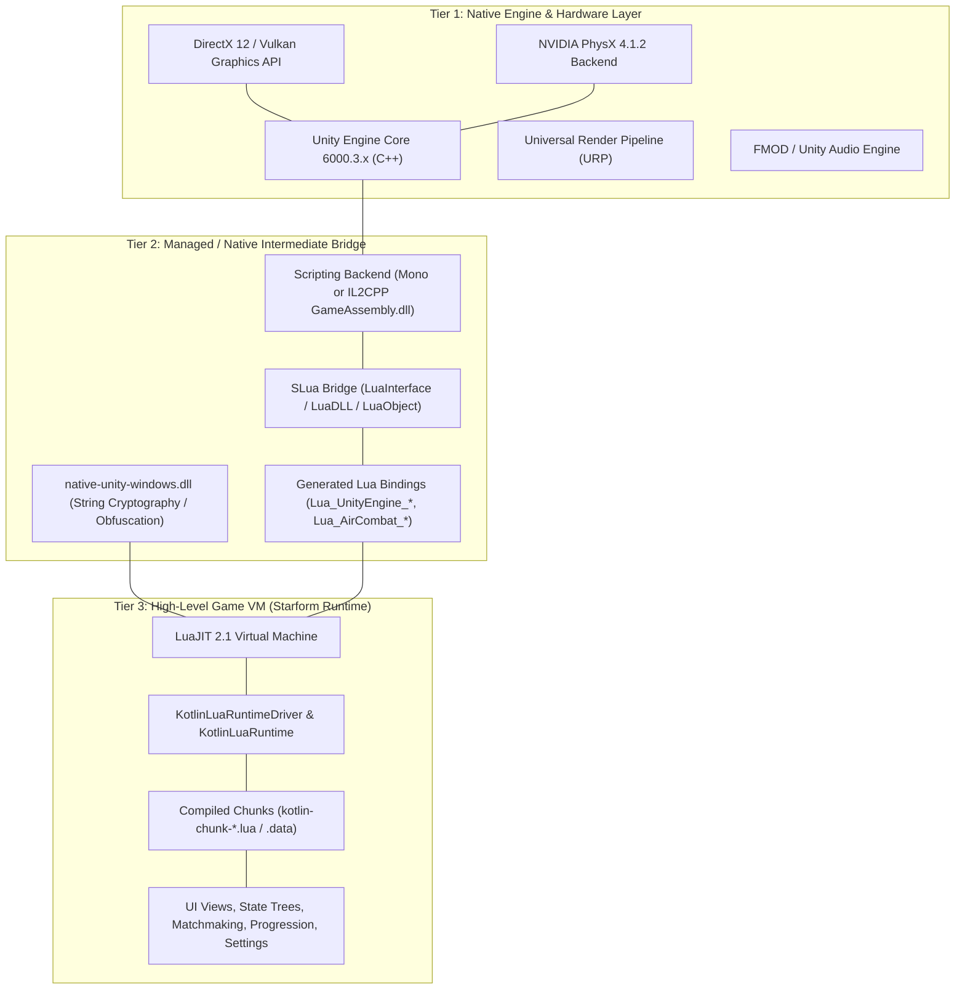
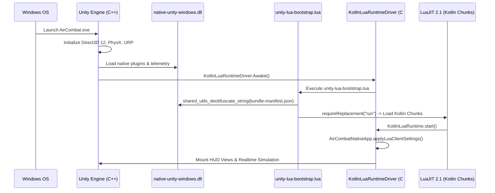
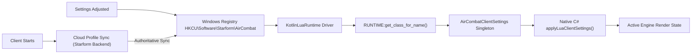

# AirCombat (Air Combat): Complete Game Engine Architecture & Reverse Engineering Specification

> **Target Audience & Purpose:**  
> This document provides an exhaustive, end-to-end technical breakdown of the native **AirCombat (Air Combat)** game client. It details the underlying engine architecture, execution flow, scripting layer, physics simulation, networking pipeline, rendering & HUD mathematics, settings lifecycle, and reverse engineering methodologies.  
> This guide is intended for developers, reverse engineers, and game programmers studying the architecture of modern commercial aerial combat titles or building an independent flight combat game from the ground up.

---

## Table of Contents
1. [High-Level Architecture & Engine Stack](#1-high-level-architecture--engine-stack)
2. [Dual-Build Ecosystem: Tournament (Mono) vs. Production (IL2CPP)](#2-dual-build-ecosystem-tournament-mono-vs-production-il2cpp)
3. [The Starform Hybrid Runtime: Kotlin-to-LuaJIT on Unity](#3-the-starform-hybrid-runtime-kotlin-to-luajit-on-unity)
4. [Startup Lifecycle & Native Bootstrap Sequence](#4-startup-lifecycle--native-bootstrap-sequence)
5. [Client Simulation & Aerodynamic Physics Engine](#5-client-simulation--aerodynamic-physics-engine)
6. [Combat Mechanics, Ballistics & Aim Assistance](#6-combat-mechanics-ballistics--aim-assistance)
7. [HUD Reticle Rendering & Mathematical Modeling](#7-hud-reticle-rendering--mathematical-modeling)
8. [Settings Persistence & Cloud Synchronization Lifecycle](#8-settings-persistence--cloud-synchronization-lifecycle)
9. [Engine Memory Management & Garbage Collection Mechanics](#9-engine-memory-management--garbage-collection-mechanics)
10. [Reverse Engineering & Decompilation Methodology](#10-reverse-engineering--decompilation-methodology)
11. [Blueprint for Building a Competitive Flight Combat Clone](#11-blueprint-for-building-a-competitive-flight-combat-clone)

---

## 1. High-Level Architecture & Engine Stack

AirCombat is built on a high-performance **hybrid engine architecture** developed by Starform. Instead of authoring gameplay logic purely in C# or native C++, the game divides its execution across three distinct tiers:



### Architectural Responsibilities:
1. **Tier 1 (Unity Core):** Handles low-level OS windows, Direct3D 12 render contexts, mesh vertex skinning, audio mixing, physical collision sweep detection, and input device polling.
2. **Tier 2 (Managed Bridge):** Acts as the high-speed data marshaller. Generated C# / IL2CPP wrappers expose engine pointers and native structs to the Lua stack without boxing overhead.
3. **Tier 3 (Starform Kotlin/Lua Layer):** The vast majority of gameplay logic, UI hierarchies, network RPC handling, and setting systems are authored in **Kotlin**, cross-compiled into optimized **Lua**, and executed within **LuaJIT 2.1**.

---

## 2. Dual-Build Ecosystem: Tournament (Mono) vs. Production (IL2CPP)

During engine analysis, two distinct architectures of the client were identified:

| Feature / Metric | Tournament Build (`AirCombat`) | Main Production Build (`production aircombat`) |
| :--- | :--- | :--- |
| **Engine Version** | Unity 6000.3.14f1 (64-bit) | Unity 6000.3.25f1 (64-bit) |
| **Scripting Backend** | **Mono** (`Assembly-CSharp.dll`) | **IL2CPP** (`GameAssembly.dll` + `il2cpp_data`) |
| **Storefront DRM** | Standalone / Beta direct launcher | **Epic Games Store** (`.egstore` integration) |
| **Progression State** | Full developer unlocked (all jets, max levels) | Live player account, matchmaking, currencies, XP |
| **Crash Reporting** | Unity standard handler | Sentry Native + Google Crashpad (`crashpad_handler.exe`) |
| **Reverse Engineering Effort** | **Direct decompilation** (C# IL via ILSpy/dnSpy) | **Native analysis** (symbols via Il2CppDumper/Ghidra) |

### Technical Implications:
* The **Tournament Mono build** contains clear symbol names, full method IL bytecodes, and complete class structures in `AirCombat_Data/Managed/Assembly-CSharp.dll`.
* The **Production IL2CPP build** compiles identical C# logic into raw x86_64 native machine instructions in `GameAssembly.dll`. 
* Both builds share the identical Starform Kotlin-to-Lua architecture, meaning game logic, protocols, and data structures are consistent across both versions.

---

## 3. The Starform Hybrid Runtime: Kotlin-to-LuaJIT on Unity

Starform's engineering pipeline compiles native Kotlin application code into Lua scripts that execute inside Unity:

```
[Kotlin Source Code] 
        │  (Kotlin AST & Static Typing)
        ▼
[Kotlin-to-Lua Cross-Compiler] 
        │  (Outputs modular Lua tables & prototype functions)
        ▼
[Obfuscation & Chunk Packager] 
        │  (Custom string XOR/hash cipher via native-unity-windows.dll)
        ▼
[content-bundle / bundle-manifest.json] 
        │  (Runtime execution)
        ▼
[LuaJIT 2.1 Virtual Machine inside Unity Client]
```

### 1. Object Model in Lua
Kotlin classes are represented in Lua as metatables with prototype inheritance:
* **Classes:** Registered in a global symbol table accessed via `RUNTIME.get_class_for_name("fully.qualified.ClassName")`.
* **Singletons:** Game systems (e.g. `apps.aircombat.client.AirCombatClientSettings`) expose a singleton accessor:
  ```lua
  local settingsClass = RUNTIME.get_class_for_name("apps.aircombat.client.AirCombatClientSettings")
  local settingsInstance = settingsClass:get_singleton()
  ```
* **Setting Objects:** Every configurable field is encapsulated within a Kotlin `Setting` object containing:
  - `getValueForNative()`: Callback queried by C# engine systems.
  - `value`: Raw in-memory state.
  - Observers / change listeners for UI reactivity.

### 2. Encryption & Asset Bundles
* In `AirCombat_Data/content-bundle/`, files are named with SHA-1/MD5 hashes (e.g., `content-000c2d2f...-v4`).
* Obfuscated scripts and manifests are decoded dynamically at startup via native bridge function:
  `shared_utils_deobfuscate_string(rawBytes)`

---

## 4. Startup Lifecycle & Native Bootstrap Sequence

When `AirCombat.exe` executes, the game transitions through a strict sequence of stages:



### Core Engine Files:
* **`boot.config`:** Unity's early configuration file parsed before any assembly loads. Controls garbage collection time-slice budgets, graphics threading mode, and rendering pipelines.
* **`unity-lua-bootstrap.lua`:** The initial scripting entry point responsible for mounting the file manifests, configuring `require` replacement loaders, and booting `run.lua`.

---

## 5. Client Simulation & Aerodynamic Physics Engine

AirCombat executes a rigid-body physical simulation coupled with realistic aerodynamic forces.

### 1. Coordinate System & World Units
* **Coordinate System:** Unity standard Left-Handed Cartesian ($X$ = Right, $Y$ = Up, $Z$ = Forward).
* **Speed Units:** Simulated in meters per second ($m/s$), displayed on the HUD in kilometers per hour ($km/h$) or knots.
* **Angular Velocity:** Calculated in radians per second and converted to degrees per second for roll/pitch/yaw rate limiters.

### 2. Aerodynamic Flight Equations
The physics simulation calculates dynamic aerodynamic lift, drag, and thrust per tick:

$$\mathbf{F}_{\text{total}} = \mathbf{F}_{\text{thrust}} + \mathbf{F}_{\text{lift}} + \mathbf{F}_{\text{drag}} + m\mathbf{g}$$

Where:
* **Thrust:**
  $$\mathbf{F}_{\text{thrust}} = T_{\text{base}} \times (\text{Throttle}) \times (1 + \text{AfterburnerMultiplier}) \cdot \hat{\mathbf{v}}_{\text{forward}}$$
* **Induced & Parasitic Drag:**
  $$F_{\text{drag}} = \frac{1}{2} \rho v^2 S C_D$$
  ($\rho$ is air density dependent on altitude, $S$ is wing reference area, $C_D$ is dynamic drag coefficient).
* **Dynamic Lift:**
  $$F_{\text{lift}} = \frac{1}{2} \rho v^2 S C_L(\alpha)$$
  ($\alpha$ is angle-of-attack; if $\alpha > \alpha_{\text{critical}}$, the aircraft enters an aerodynamic stall, inducing roll instability and lift loss).

### 3. Simulation Dispatch Pipeline
* Client simulation runs inside `AirCombat.AirCombatNativeClientRealtimeSimulation:update(deltaTime, unscaledTime)`.
* Network state prediction and dead reckoning extrapolate remote aircraft positions:
  - `networkReductionDistance_aircraft_predictionMode_simulate`
  - `networkReductionDistance_aircraft_update_interpolate`
  - `networkReductionDistance_aircraft_update_extrapolate`

---

## 6. Combat Mechanics, Ballistics & Aim Assistance

### 1. Ballistic Cannon Fire & Lead Reticle Calculation
Cannons fire physical projectile entities with initial velocity inheriting the host aircraft's velocity vector:

$$\mathbf{v}_{\text{bullet}} = \mathbf{v}_{\text{aircraft}} + v_{\text{muzzle}} \cdot \hat{\mathbf{d}}_{\text{barrel}}$$

To calculate where the player must aim to hit a moving target at distance $D$, the client solves for Time-to-Impact ($t_{\text{tti}}$):

$$t_{\text{tti}} \approx \frac{\|\mathbf{p}_{\text{target}} - \mathbf{p}_{\text{player}}\|}{v_{\text{muzzle}} + (\mathbf{v}_{\text{player}} \cdot \hat{\mathbf{d}}_{\text{forward}})}$$

The predicted impact position ($\mathbf{p}_{\text{lead}}$) is:

$$\mathbf{p}_{\text{lead}} = \mathbf{p}_{\text{target}} + (\mathbf{v}_{\text{target}} \times t_{\text{tti}}) + \frac{1}{2} \mathbf{g} t_{\text{tti}}^2$$

The HUD projects $\mathbf{p}_{\text{lead}}$ from 3D world space into 2D camera viewport coordinates to draw the **Gun Lead Reticle**.

### 2. Native Aim Assistance Hierarchy
Decompiled from `AirCombatClientSettings`:

1. **`enableCannonAutoAim`:** When active, rounds leaving the barrel undergo angular trajectory correction toward the target's projected lead point within a defined tolerance cone.
2. **`enableIdleAutoAim`:** Gently pulls the aircraft's nose toward the target when no active manual deflection is input.
3. **`enableCannonAutoZoom`:** Automatically shifts camera field-of-view from `baseFieldOfView` (~60°) to `fullyZoomedFieldOfView` (~35°) when firing cannons.
4. **`axisCursor_showGuide`:** Renders the flight trajectory lead notch on screen indicating the target plane's future flight vector.

---

## 7. HUD Reticle Rendering & Mathematical Modeling

The central crosshairs and targeting elements are managed by `AirCombat.HUD.HudReticleSystem` and rendered via `AirCombat.HUD.HudReticleView`.

### 1. Reticle Sizing Formula
In `HudReticleSystem.cs`, reticle dimensions are computed as:

$$\text{ReticleScaleFactor} = \text{AirCombatClientSettings.hudReticleScaleFactor}$$
$$\text{ForwardReticleWidth} = \text{BaseWidth} \times 0.0025 \times \text{ReticleScaleFactor}$$
$$\text{ForwardReticleHeight} = \text{BaseHeight} \times 0.0025 \times \text{ReticleScaleFactor}$$

### 2. The Native UI Constraint Architecture
In the vanilla game:
* The Kotlin UI slider (`SliderView_Props_893c71` in `kotlin-chunk-47.data`) enforces:
  $$\text{SliderRange} = [0.50, 1.50] \quad (50\% \text{ to } 150\%)$$
* However, in the underlying C# rendering code, `hudReticleScaleFactor` is **completely unclamped** at runtime.
* The rendering engine treats the value as an open multiplier without an internal lower-bound check.

---

## 8. Settings Persistence & Cloud Synchronization Lifecycle

Understanding how settings persist is key to understanding the client's state architecture:



### Mechanics:
1. `PlayerPrefs` on Windows are saved in `HKEY_CURRENT_USER\Software\Starform\AirCombat`.
2. Floating-point numbers are stored as `REG_DWORD` using standard 32-bit IEEE 754 encoding.
3. **Cloud Synchronization:** When launching and logging into an active account, the client receives authoritative profile data from the backend servers, updating local registry keys with cloud preferences.

---

## 9. Engine Memory Management & Garbage Collection Mechanics

### 1. Unity Garbage Collector Pipeline
* AirCombat utilizes Unity's Boehm incremental garbage collector.
* Engine parameters in `boot.config` regulate GC frame budgeting:
  - `gc-max-time-slice`: Maximum millisecond budget allocated to GC per frame.
  - `gc-incremental`: Flag enabling frame-sliced incremental collection.

### 2. Asset Lifecycle & Object Allocation
* Dynamic asset loading flows through `Platform.AssetBundleLoader:loadAsset`.
* The client implements pooling systems to manage memory overhead during combat:
  - `VehicleLocatorsPool`
  - `UnityElements.PrefabInstancePool`
  - `AirCombat.HUD.HudPrefabPool`
* If pooling is bypassed or asset unloading is invoked while async bundles load, the engine stalls rendering threads while performing synchronous asset mark-and-sweep passes.

---

## 10. Reverse Engineering & Decompilation Methodology

For developers analyzing the game binaries and scripts:

### 1. Decompiling the Mono Build
* **Tooling:** ILSpy, dnSpy, or JetBrains dotPeek.
* **Target File:** `AirCombat_Data/Managed/Assembly-CSharp.dll`.
* **Key Namespaces to Inspect:**
  - `AirCombat.HUD`: All reticle formulas, indicators, radar maps, and screen overlays.
  - `AirCombat.Simulation`: Realtime aircraft physics, weapon state, collision handlers.
  - `Platform`: SLua bindings, networking wrappers, asset bundle loaders.

### 2. Inspecting the IL2CPP Build
* **Tooling:** Il2CppDumper, Ghidra, IDA Pro.
* **Target Files:**
  - `GameAssembly.dll`: Contains native compiled instructions.
  - `AirCombat_Data/il2cpp_data/Metadata/global-metadata.dat`: Contains type definitions, field names, and string literals.
* Running `Il2CppDumper.exe GameAssembly.dll global-metadata.dat output/` produces `dump.cs` with all class structures, method offsets, and vtable addresses.

### 3. Inspecting the Lua Runtime
* The bootstrap file `AirCombat_Data/unity-lua-bootstrap.lua` can be inspected in any text editor.
* Exported symbols from `native-unity-windows.dll`:
  - `native_unity_start`: Initializes Lua state.
  - `shared_utils_deobfuscate_string`: Reverses string encryption on content chunks.

---

## 11. Blueprint for Building a Competitive Flight Combat Clone

If designing an independent aerial combat game with similar high-responsiveness and tight dogfighting physics, consider this architecture:

### 1. Technology Recommendations
* **Engine:** Unity (Universal Render Pipeline) or Unreal Engine 5.
* **Physics Model:** Rigid-body dynamics combined with lookup tables for lift/drag coefficients based on Mach and Angle-of-Attack ($\alpha$).
* **Input Architecture:** Raw mouse/stick vector translation to rotational acceleration with dynamic sensitivity curves.

### 2. Aerodynamic Flight Model Implementation (C#)
```csharp
using UnityEngine;

[RequireComponent(typeof(Rigidbody))]
public class AerodynamicFlightModel : MonoBehaviour
{
    [Header("Airframe Specifications")]
    public float wingArea = 27.87f;          // Wing surface area (m^2)
    public float emptyMass = 8500f;           // Aircraft mass (kg)
    public float maxMilitaryThrust = 76000f;  // Newtons
    public float maxAfterburnerThrust = 127000f; // Newtons

    [Header("Flight State")]
    public float throttle = 0.5f;             // 0.0 to 1.0
    public bool afterburner = false;
    public Vector3 controlInputs;             // X: Pitch, Y: Yaw, Z: Roll

    private Rigidbody rb;

    void Awake()
    {
        rb = GetComponent<Rigidbody>();
        rb.mass = emptyMass;
    }

    void FixedUpdate()
    {
        Vector3 velocity = rb.linearVelocity;
        float speed = velocity.magnitude;
        Vector3 forward = transform.forward;
        Vector3 up = transform.up;

        // 1. Altitude & Atmospheric Density (Barometric approximation)
        float altitude = Mathf.Max(0f, transform.position.y);
        float airDensity = 1.225f * Mathf.Exp(-altitude / 8500f);
        float dynamicPressure = 0.5f * airDensity * speed * speed;

        // 2. Angle of Attack (Alpha) & Sideslip (Beta)
        float alpha = Vector3.Angle(forward, velocity);
        if (Vector3.Dot(up, velocity) < 0) alpha = -alpha;

        // 3. Coefficients (Simplified NACA 64A010 airfoil curves)
        float liftCoeff = Mathf.Clamp(alpha * 0.08f, -1.2f, 1.2f);
        float dragCoeff = 0.02f + (0.05f * liftCoeff * liftCoeff);

        // 4. Force Vectors
        Vector3 liftDirection = Vector3.Cross(Vector3.Cross(velocity, up), velocity).normalized;
        Vector3 liftForce = liftDirection * (dynamicPressure * wingArea * liftCoeff);
        Vector3 dragForce = -velocity.normalized * (dynamicPressure * wingArea * dragCoeff);

        float currentThrust = (afterburner ? maxAfterburnerThrust : maxMilitaryThrust) * throttle;
        Vector3 thrustForce = forward * currentThrust;

        // 5. Apply Forces to Rigidbody
        rb.AddForce(thrustForce + liftForce + dragForce, ForceMode.Force);

        // 6. Angular Control Moments (Scaled by dynamic pressure)
        float controlAuthority = Mathf.Clamp01(dynamicPressure / 6000f);
        Vector3 torques = new Vector3(
            controlInputs.x * 110f, // Pitch rate (deg/s^2)
            controlInputs.y * 30f,  // Yaw rate
            controlInputs.z * 220f  // Roll rate
        );
        rb.AddRelativeTorque(torques * controlAuthority, ForceMode.Acceleration);
    }
}
```

### 3. Essential Flight Combat Design Principles
1. **Unclamped Presentation:** Keep HUD reticle dimensions and FOV scalers independent of UI slider minimums so competitive players can fine-tune their visual experience.
2. **Deterministic Ballistics:** Calculate projectile trajectories with velocity inheritance so that aircraft speed directly impacts projectile range and lead requirements.
3. **Decouple UI from Simulation:** Maintain separate tick rates for visual HUD interpolation (high refresh 120/144 Hz) and physics/network simulation (60 Hz fixed tick) to ensure responsive rendering without desynchronizing network state.

---
*Technical reference compiled from reverse engineering analysis of AirCombat (Air Combat) Windows builds.*
